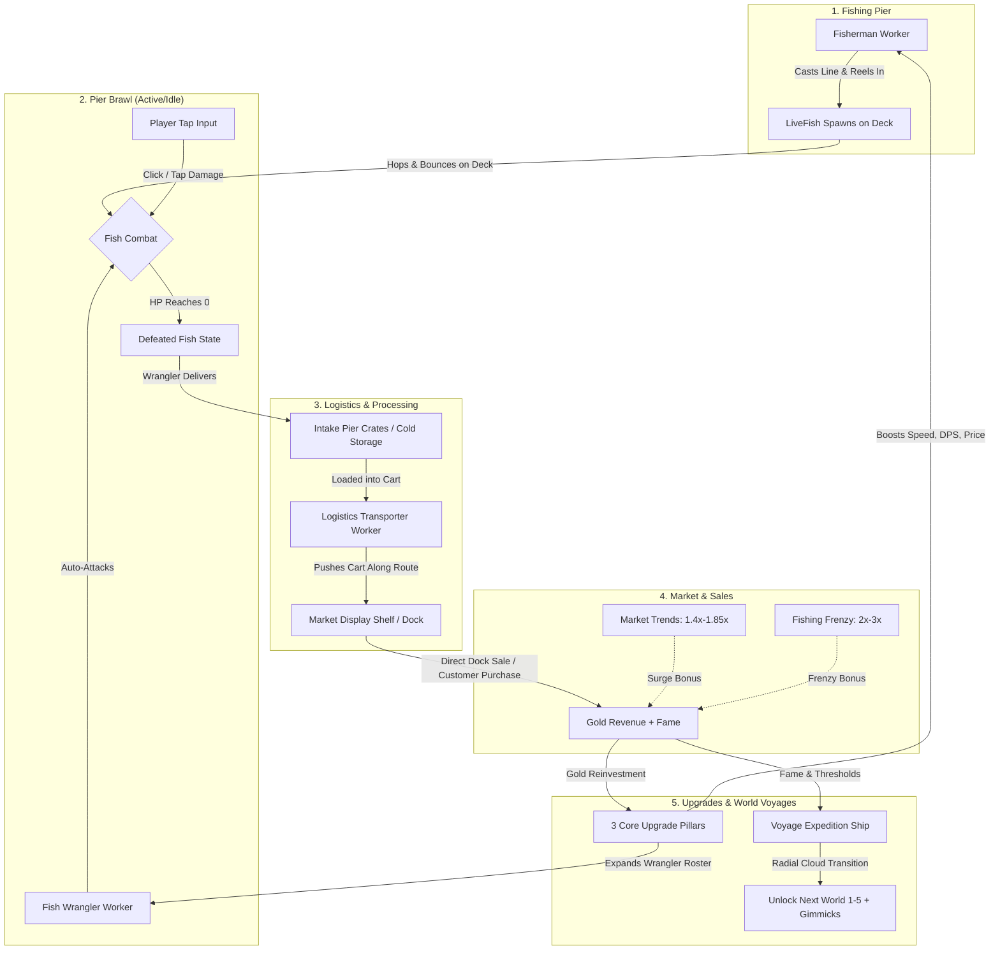
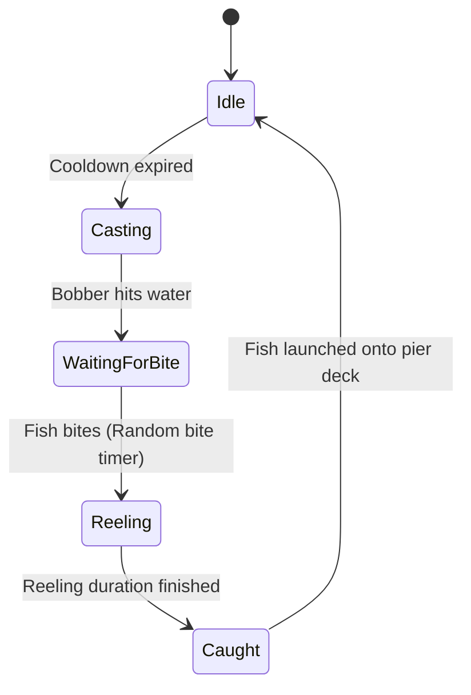
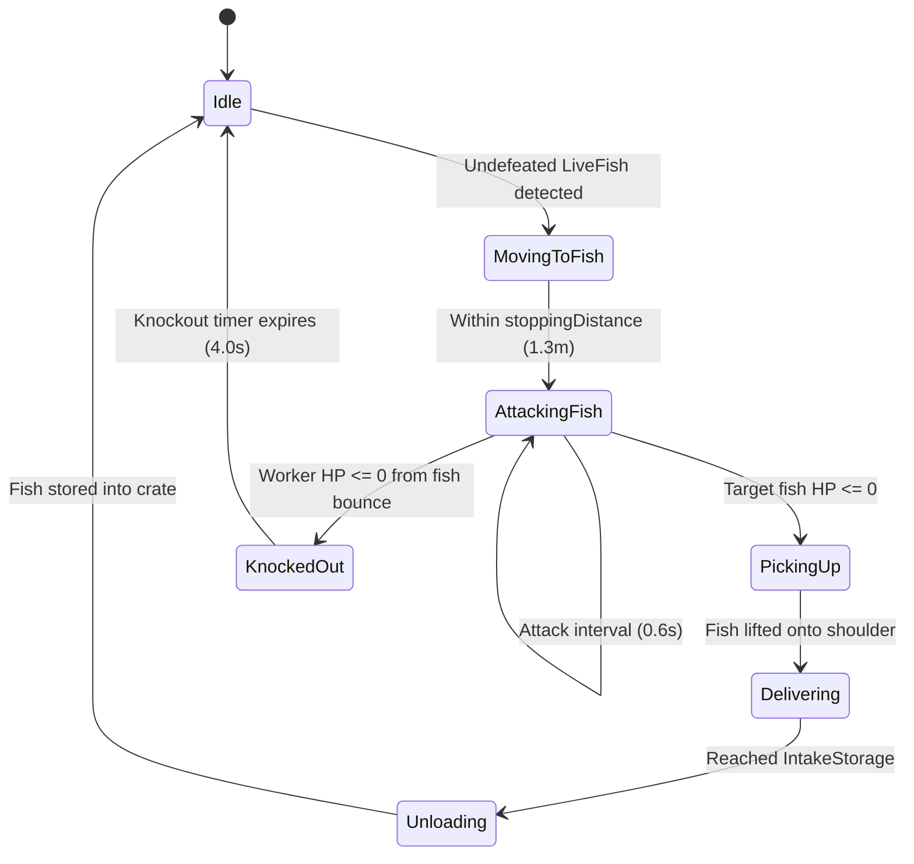

# Idle Fishing — Gameplay Architecture & Systems Design Specification

> **Document Purpose**: This comprehensive specification details the complete gameplay architecture, mechanics, state machines, mathematical models, and data pipelines of the **Idle Fishing** project. It is structured specifically for game designers, systems engineers, and AI models to analyze, rebalance, optimize, or extend the gameplay.

---

## Table of Contents
1. [High Concept & Core Game Loop](#1-high-concept--core-game-loop)
2. [High-Level Architecture & Event Bus](#2-high-level-architecture--event-bus)
3. [Subsystems Deep Dive](#3-subsystems-deep-dive)
   - [3.1 Fishing Subsystem (Anglers & Rods)](#31-fishing-subsystem-anglers--rods)
   - [3.2 Combat & Wrangling Subsystem (Live Fish & Brawlers)](#32-combat--wrangling-subsystem-live-fish--brawlers)
   - [3.3 Logistics & Warehousing Subsystem (Cart Transporters)](#33-logistics--warehousing-subsystem-cart-transporters)
   - [3.4 Market, Trends & Customer Subsystem](#34-market-trends--customer-subsystem)
   - [3.5 Aquarium & Tourism Subsystem](#35-aquarium--tourism-subsystem)
   - [3.6 World Progression & Signature Gimmicks](#36-world-progression--signature-gimmicks)
4. [Mathematical Models & Economy Formulas](#4-mathematical-models--economy-formulas)
   - [4.1 Fish Valuation Formula](#41-fish-valuation-formula)
   - [4.2 Upgrade Cost & Scaling Formula](#42-upgrade-cost--scaling-formula)
   - [4.3 Frenzy & Multiplier Stacking](#43-frenzy--multiplier-stacking)
   - [4.4 Aquarium Passive Gold Generation](#44-aquarium-passive-gold-generation)
5. [Complete Class & Data Reference Map](#5-complete-class--data-reference-map)
6. [Extension Points & Recommendations for Optimization](#6-extension-points--recommendations-for-optimization)

---

## 1. High Concept & Core Game Loop

### 1.1 Genre & Vision
**Idle Fishing** is a 3D isometric hybrid **Idle Tycoon / Casual Arcade Management** game built in Unity (URP). It blends the tactile, immediate satisfaction of arcade brawlers (whacking flopping sea monsters on the pier, active tapping) with deep idle-tycoon logistics (automated angling, conveyor/cart transport, market shelf stocking, customer sales, and cross-world voyages).

### 1.2 Core Game Loop Diagram



---

## 2. High-Level Architecture & Event Bus

The codebase follows a **Decoupled Manager-Worker** architecture powered by an asynchronous **C# Event Bus** (`GameEvents.cs`). Subsystems do not hard-reference one another; instead, they communicate through static broadcast delegates.

### 2.1 Event Bus (`GameEvents.cs`)
Key global events registered across the application:
- `FishermanCaughtFish(FishChainData species, bool isBoss, FishSizeCategory size, FishQualityTier quality)`
- `FishDefeated(FishChainData species, LiveFish fishInstance)`
- `BossFishDefeated(FishChainData species, int bonusGold)`
- `ItemSold(ItemData item, int finalPrice)`
- `CoinsChanged(int newBalance)`
- `WorldChanged(WorldData newWorld)`
- `MarketTrendChanged(MarketTrend trend)`
- `FrenzyChargeChanged(float currentCharge)`
- `HarborFameChanged(int totalFame, int harborLevel)`
- `QuestProgressUpdated(QuestStep quest, int current, int target)`
- `QuestCompleted(QuestStep quest)`

### 2.2 Singleton Managers & Roles
| Manager | Namespace | Core Responsibility |
|---|---|---|
| `WorldManager` | `IdleFishing.Core` | Active world lifecycle, world switching (1 to 5), save/load persistency. |
| `EconomyManager` | `IdleFishing.Economy` | Player coin balance, transaction processing, coin fly FX triggers. |
| `UpgradeManager` | `IdleFishing.Economy` | Reads `UpgradeConfig`, handles level calculation, costs, and value caching. |
| `FishingPierManager` | `IdleFishing.Fishing` | Allocates dock slots, coordinates anglers and live fish density limits. |
| `WranglerManager` | `IdleFishing.Fishing` | Spawns, equips, and routes melee fish wranglers. |
| `FishingFrenzyManager` | `IdleFishing.Fishing` | Tracks frenzy bar charge (0-100), executes timed 20s frenzy events. |
| `LogisticsManager` | `IdleFishing.Logistics` | Manages intake inventories, storage buffers, and transporter routes. |
| `MarketTrendManager` | `IdleFishing.Market` | 120s rotating market cycles applying price surges to specific fish families. |
| `ContractManager` | `IdleFishing.Market` | Tracks harbor reputation/fame, milestone promotions, and trade contracts. |
| `AquariumManager` | `IdleFishing.Aquarium` | Passive income generation from collected rare species, tank decor upgrades. |
| `WorldGimmickManager` | `IdleFishing.Gimmicks` | Coordinates world-specific signature interactive mechanics. |
| `QuestManager` | `IdleFishing.Quests` | Step-by-step questline guiding player unlocks and progression. |

---

## 3. Subsystems Deep Dive

### 3.1 Fishing Subsystem (Anglers & Rods)

#### Finite State Machine: `FishermanWorker.cs`
Anglers operate on a dedicated state machine:


- **Spawn Roll**: Uses `FishChainData.spawnWeight` to pick species from the active world's pool.
- **RNG Size & Quality Tiers**:
  - **Size Categories**: `Standard` (75%), `Big` (18%), `Colossal` (7%).
  - **Quality Tiers**: `Regular` (80%), `Silver` (14%), `Golden` (5%), `Rainbow` (1%).
- **Boss Spawning**: High-tier species or specific milestone rolls spawn as **Apex Boss Fish** (e.g., Blacktip Shark, Colossal Manta Ray) with customized health pools and gold bounties.
- **Trajectory Arc**: Once caught, the fish is propelled through the air along a parabolic trajectory using `Vector3.Slerp` / custom arc math onto the pier battle deck.

---

### 3.2 Combat & Wrangling Subsystem (Live Fish & Brawlers)

#### 1. Live Fish Entity (`LiveFish.cs`)
Unlike traditional idle fishing games where fish instantly convert to inventory items, fish in this game land alive on the pier deck as active physical brawlers:
- **Flop / Hop Physics**: The fish randomly hops around a bounded arena radius (`hopDistance = 1.5m`, `hopHeight = 1.1m`, parabolic arc with squash & stretch wiggle).
- **Hazard Contact Damage**: If a hopping fish collides with a worker, it inflicts contact damage (`fishAttackDamage = 16`), knocking the worker backward or triggering a brief stun.
- **Dual Damage Input**:
  1. *Idle / Automated*: Fish Wranglers chase down and whack the fish with clubs/paddles.
  2. *Active / Player Tap*: Players can directly tap/click on hopping fish to deal rapid burst damage with sword slash VFX.
- **Visual Feedback**: Real-time squash & stretch mesh deformation (`FishHitReactionRoutine`), material color flashing (red on hit), and floating damage numbers (`FloatingDamageManager`).
- **Defeat State**: When HP drops to 0, the fish flops onto its side, spawns stun stars overhead, charges the Frenzy bar, and awaits pickup.

#### 2. Fish Wrangler Worker (`FishWranglerWorker.cs`)


- **Health & Knockout**: Wranglers have a health bar. If reduced to 0 by violent fish hops, they collapse (`KnockedOut` for 4s) before recovering.
- **Auto-Revive & Crowd Avoidance**: Integrates `CrowdAvoidance.cs` to prevent stacking and path blocking.

---

### 3.3 Logistics & Warehousing Subsystem (Cart Transporters)

#### Transporter Worker (`LogisticsTransporterWorker.cs`)
Transporters automate moving products from dock intake crates to market stalls:
- **Vehicle**: Pushes a 3D wooden cart with procedural wheel rotation linked to distance traversed.
- **Multi-Item Capacity**: Holds `maxCarryCapacity` (base 3, scalable with upgrades) items simultaneously, visually rendered as a stacked pile.
- **State Machine**:
  `Idle` $\rightarrow$ `MovingToPickup` $\rightarrow$ `Loading` $\rightarrow$ `MovingToDropoff` $\rightarrow$ `Unloading`.
- **Payload Data Preservation**: Preserves the exact `FishQualityTier` and `FishSizeCategory` of each caught fish into `CarriedFishPayload` so size/quality multipliers are rewarded upon sale.
- **Steering**: Uses tangential soft separation (`CrowdAvoidance`) so carts smoothly slip past anglers, wranglers, and tourists without gridlocks.

---

### 3.4 Market, Trends & Customer Subsystem

1. **Display Shelves (`DisplayShelf.cs`)**:
   - Stocked by transporters.
   - Holds physical 3D representations of whole fish or processed trays.
2. **Customer AI (`CustomerNPC.cs` & `CustomerSpawner.cs`)**:
   - Spawns customer tiers:
     - **Casual Shopper**: Regular walk speed, standard purchase.
     - **Tourist**: Lingers longer, buys multiple items, leaves small gold tips.
     - **VIP Buyer**: Dressed in regal attire, pays extra premium tip on high-tier fish.
3. **Dynamic Market Trends (`MarketTrendManager.cs`)**:
   - 120-second rotating cycles.
   - Selects a trend from the world's thematic trend pool (e.g., *Wild Salmon Season*, *Snow Crab Gala*, *Arctic Tuna Rush*).
   - Grants **1.4x to 1.85x** price multipliers when selling matched species.
4. **Harbor Fame & Promotion (`ContractManager.cs`)**:
   - Fulfilling market orders grants **Harbor Fame**.
   - Gaining enough Fame levels up the harbor (Levels 1 to 4), permanently increasing sell prices and processing speed.

---

### 3.5 Aquarium & Tourism Subsystem

- **Aquarium Tank Visuals (`AquariumManager.cs`)**:
  - Allows players to exhibit caught species (especially rare, colossal, and boss fish).
  - Generates passive income (gold per second) based on the fish's rarity tier and the tank's decor level.
- **Tourist Interaction (`AquariumTouristAgent.cs`)**:
  - Independent NPC agents walk through the aquarium zone, admiring fish tanks.
  - Periodic reaction trigger: tourists take photos and pop `+TIP!` gold bonuses into the economy.
- **Bestiary Milestones (`BestiaryManager.cs`)**:
  - Unlocking $\ge 3$ unique species: `+15%` fishing speed.
  - Unlocking $\ge 5$ unique species: `+20%` fish sell price.
  - Unlocking $\ge 7$ unique species: `+30%` wrangler attack damage & `+50%` aquarium tourist tips.

---

### 3.6 World Progression & Signature Gimmicks

Players progress through 5 themed ocean worlds via the **Expedition Ship** (`OffshoreTravelShip.cs`):

| World Order | World ID | Name / Theme | Signature Gimmick | Gimmick Mechanics & Buffs |
|---|---|---|---|---|
| **Level 1** | `world_1` | **Temperate Bay** | *Apex Blacktip Shark* | Core automation, baseline dock brawling, periodic pirate bounty boss. |
| **Level 2** | `world_2` | **Tropical Coral Atoll** | *Giant Clam & Pearls* (`GiantClamPearlGimmick.cs`) | Clam periodically opens underwater. Player taps to collect 3 Golden Pearls $\rightarrow$ triggers **Pearl Frenzy: 3x Sell Value** for 20s. |
| **Level 3** | `world_3` | **Autumn Smoker Haven** | *Autumn Smoker Grill* (`SmokerGrillGimmick.cs`) | Charcoal smoker on dock. Player taps repeatedly to fan flames; sells grilled fish for **4x Gold**. |
| **Level 4** | `world_4` | **Arctic Frostfjord** | *Blizzard & Icebreaker* (`ArcticBlizzardGimmick.cs`) | Blizzard slows anglers by 50% & spawns Treasure Iceberg. Rapidly tap to shatter ice $\rightarrow$ **Gold Shower + 2x Fishing Speed**. |
| **Level 5** | `world_5` | **Desert Oasis Harbor** | *Desert Caravan & Relics* (`DesertCaravanGimmick.cs`) | Camel caravan requests fish shipments. Fulfilling quotas permanently unlocks **3 Sacred Relics** (+30% Speed, +50% Price, Genie Lamp). |

---

## 4. Mathematical Models & Economy Formulas

### 4.1 Fish Valuation Formula
When a fish item is sold (at the market shelf or dock cargo export), its final sell price $P_{\text{final}}$ is calculated as:

$$P_{\text{final}} = \left\lfloor P_{\text{base}} \times M_{\text{tier}} \times M_{\text{size}} \times M_{\text{quality}} \times M_{\text{trend}} \times M_{\text{upgrade}} \times M_{\text{frenzy}} \times M_{\text{relic}} \right\rfloor$$

#### Multiplier Values:
- **Base Price ($P_{\text{base}}$)**: Configured in `ItemData.basePrice` (typically 10 to 120 Gold depending on species tier).
- **Size Multiplier ($M_{\text{size}}$)**:
  - `Standard`: $1.0\times$
  - `Big`: $1.5\times$
  - `Colossal`: $2.2\times$
- **Quality Multiplier ($M_{\text{quality}}$)**:
  - `Regular`: $1.0\times$
  - `Silver`: $1.5\times$
  - `Golden`: $3.0\times$
  - `Rainbow`: $5.0\times$
- **Market Trend Multiplier ($M_{\text{trend}}$)**:
  - Non-trend: $1.0\times$
  - Active trend match: $1.4\times$ to $1.85\times$
- **Upgrade Multiplier ($M_{\text{upgrade}}$)**:
  - Derived from `FishValue` upgrade level: $1.0 + (\text{level} \times 0.25)$
- **Frenzy Multiplier ($M_{\text{frenzy}}$)**:
  - Standard Frenzy: $2.0\times$
  - Pearl Frenzy (World 2): $3.0\times$
- **Desert Relic Multiplier ($M_{\text{relic}}$)**:
  - Jade Scarab unlocked: $1.5\times$

---

### 4.2 Upgrade Cost & Scaling Formula
Upgrades in `UpgradeConfig.cs` follow a geometric progression curve to ensure exponential progression pacing:

$$\text{Cost}(\text{level}) = \text{round}\left( C_{\text{base}} \times (R_{\text{cost}})^{\text{level}} \right)$$

$$\text{Value}(\text{level}) = V_{\text{base}} + (\text{level} \times \Delta V)$$

#### Baseline Tuning Parameters:
- **Base Cost ($C_{\text{base}}$)**: $50$ Gold
- **Cost Ratio ($R_{\text{cost}}$)**: $1.60$
- **Value Step ($\Delta V$)**: $+25\%$ per level
- **Max Level**: $10$ per world

#### 3 Streamlined Upgrade Pillars:
1. `FishermanTeam`: Increases fishing cast/reel speed and expands total pier angler slots.
2. `WranglerTeam`: Increases wrangler damage, movement speed, and hires additional brawlers.
3. `FishValue`: Multiplies the base sale value of all caught seafood across stalls and exports.

---

### 4.3 Frenzy & Multiplier Stacking

$$\text{Frenzy Charge Rate} = \frac{\Delta \text{Charge}}{\text{Fish Defeated}} = 6.0\% \quad (\text{17 catches to trigger 100\%})$$

- When meter hits 100%, **Fishing Frenzy** activates for **20.0 seconds**:
  - Angler Reel & Cast Speed: $2.0\times$
  - Wrangler Move & Attack Speed: $1.5\times$
  - Gold Value on Sale: $2.0\times$
- **Peak Multiplier Synergy Example**:
  A **Colossal** ($2.2\times$), **Rainbow** ($5.0\times$) Tuna during **Active Market Trend** ($1.6\times$) with **Pearl Frenzy** ($3.0\times$) yields:
  $$2.2 \times 5.0 \times 1.6 \times 3.0 = 52.8\times \text{ Base Gold!}$$
  *(Creates massive dopamine jackpot moments for player retention).*

---

### 4.4 Aquarium Passive Gold Generation

$$G_{\text{passive}} = \sum_{i=1}^{N} \left( R_{\text{species}, i} \times M_{\text{tier}, i} \right) \times M_{\text{decor}}$$

- **Decor Multipliers**:
  - Level 1 (Basic Glass Tank): $1.0\times$
  - Level 2 (Coral LED Lighting): $1.35\times$
  - Level 3 (Tropical Biome): $1.80\times$
  - Level 4 (Royal Pearl Castle): $2.50\times$
- **Tourist Tips**: Every $4\text{s} - 8\text{s}$, roaming tourists generate:
  $$\text{Tip} = \text{Random}(3, 8) \times \text{DecorLevel}$$

---

## 5. Complete Class & Data Reference Map

```
Assets/Scripts/
├── Aquarium/
│   ├── AquariumManager.cs          # Passive income generator & tank state
│   ├── AquariumTouristAgent.cs      # Roaming tourist AI & tipping
│   ├── AquariumTankVisual.cs        # 3D fish swimming instantiation
│   └── BestiaryManager.cs           # Species collection milestones
├── Core/
│   ├── GameEvents.cs                # Global decoupled Event Bus
│   ├── WorldManager.cs              # Active world orchestration (World 1-5)
│   ├── CrowdAvoidance.cs            # Soft lateral separation steering for crowd
│   └── NumberFormatter.cs           # Tycoon suffix formatter (1K, 1.5M, 2B)
├── Data/
│   ├── FishChainData.cs             # ScriptableObject: species HP, tier, spawn weights
│   ├── FishQualityData.cs           # Enums & price multipliers for size & quality
│   ├── UpgradeConfig.cs             # ScriptableObject: cost curve & tier formulas
│   ├── WorldData.cs                 # ScriptableObject: world order, unlocks, metadata
│   └── ItemData.cs                  # ScriptableObject: base item prices & icon assets
├── Economy/
│   ├── EconomyManager.cs            # Coin wallet balance & transaction validation
│   ├── UpgradeManager.cs            # Handles level persistence and upgrade execution
│   └── PrestigeManager.cs           # Harbor fame & prestige bonus calculations
├── Fishing/
│   ├── FishermanWorker.cs           # Angler worker FSM (cast, reel, catch)
│   ├── LiveFish.cs                  # Deck combat entity: hops, HP, flash hit reaction
│   ├── FishWranglerWorker.cs        # Melee brawler FSM (attack, knockout, deliver)
│   ├── FishingPierManager.cs        # Dock slot assignments & fish density controller
│   ├── FishingFrenzyManager.cs      # Frenzy meter accumulation and activation
│   └── WranglerManager.cs           # Wrangler team roster and equipment upgrades
├── Gimmicks/
│   ├── WorldGimmickManager.cs       # Coordinates world-specific signature gimmicks
│   ├── ArcticBlizzardGimmick.cs     # World 4: Blizzard event, ice-tap breaking
│   ├── GiantClamPearlGimmick.cs     # World 2: Clam pearl harvest, Pearl Frenzy
│   ├── SmokerGrillGimmick.cs        # World 3: Smoked BBQ grilling active tap
│   └── DesertCaravanGimmick.cs      # World 5: Camel trade orders, 3 ancient relics
├── Logistics/
│   ├── LogisticsManager.cs          # Warehouse coordination & storage buffers
│   ├── LogisticsTransporterWorker.cs# Cart pusher FSM, multi-item carrying, sales
│   └── WorldTransporterHirePad.cs   # In-world upgrade pad for hiring haulers
├── Market/
│   ├── MarketTrendManager.cs        # 2-minute dynamic price surge generator
│   ├── MarketTrend.cs               # Trend data model (multiplier, duration, species)
│   ├── DisplayShelf.cs              # Market shelves holding fish for sale
│   ├── CustomerSpawner.cs           # Spawns Casual, Tourist, and VIP customers
│   ├── CustomerNPC.cs               # Customer navigation, purchase, and tip logic
│   └── ContractManager.cs           # Harbor fame contracts & promotion ranks
├── Quests/
│   ├── QuestManager.cs              # Step-by-step quest milestones and rewards
│   └── QuestData.cs                 # ScriptableObject: quest targets and coin rewards
├── UI/
│   ├── GameHUD.cs                   # Top HUD, coin counter, world level display
│   ├── CollapsibleUpgradeMenuUI.cs  # Bottom floating upgrade tray
│   ├── WorldUnlockCelebrationModal.cs# Modal celebrating new world voyages
│   ├── VoyageTransitionUI.cs        # Fullscreen circular toon cloud transition
│   ├── WorldGimmickHUDUI.cs         # Persistent widget for active world gimmick
│   ├── FishingFrenzyHUDUI.cs        # Frenzy meter bar and countdown pulse
│   └── FloatingDamageManager.cs     # Object-pooled 3D animated damage/tip popups
└── World/
    ├── OffshoreTravelShip.cs        # Interactive voyage ship at dock
    ├── DayNightCycleManager.cs      # Lighting & directional sun rotation
    ├── ToonEnvironmentThemeController.cs # Swaps seasonal terrain materials per world
    └── SeasideCafeController.cs     # Seaside cafe secondary revenue building
```

---

## 6. Extension Points & Recommendations for Optimization

For another AI model or developer reviewing this codebase, the following architectural opportunities and feature extensions are prime candidates for implementation:

### 6.1 Performance & Memory Optimizations
1. **Object Pooling for LiveFish & VFX**:
   - Currently, `LiveFish` instances and particle systems are instantiated on catch and destroyed on storage.
   - *Recommendation*: Introduce an `ObjectPool<LiveFish>` in `FishingPierManager` to reuse mesh renderers, colliders, and health bar canvasses, reducing Garbage Collection spikes on mobile devices.
2. **Crowd Avoidance Optimization**:
   - `CrowdAvoidance.cs` currently scans nearby colliders via `Physics.OverlapSphere` in `FixedUpdate`.
   - *Recommendation*: Replace spatial physics queries with a lightweight 2D grid/spatial hash table (`SpatialHashGrid`), or integrate Unity's NavMesh Obstacle avoidance.
3. **Save/Load Serialization**:
   - Currently uses `PlayerPrefs` for individual keys.
   - *Recommendation*: Consolidate game state into a unified JSON save profile (`GameSaveData.json`) written asynchronously with checksum validation.

### 6.2 Gameplay Depth & Balance Tuning
1. **Gear & Equipment Customization**:
   - Add specialized fishing rods (e.g., *Magnetic Reel*, *Deep-Sea Lure*) and wrangler clubs (e.g., *Stun Hammer*, *Golden Cleaver*) with unique passive procs.
2. **Weather & Day/Night Gameplay Influence**:
   - `DayNightCycleManager` is currently visual.
   - *Recommendation*: Hook day/night into fish behavior (e.g., nocturnal bioluminescent fish catchable only at night with $2.5\times$ value).
3. **Cooking & Recipe Crafting Expansion**:
   - Extend the World 3 Smoker Grill mechanic into a full secondary kitchen system (`KitchenManager`), allowing fish fillets + seaweed/rice to be packaged into luxury bento boxes for $5\times$ export value.
4. **Offline Progression (AFK Earnings)**:
   - Calculate elapsed timestamp on boot (`DateTime.UtcNow - LastSaveTime`) and reward an offline revenue package capped at 8 hours, boosted by VIP customer or aquarium upgrades.
