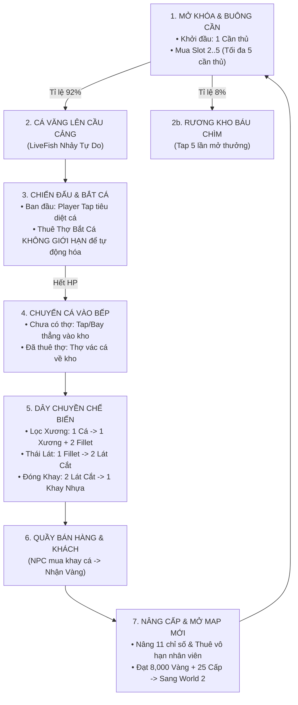

# TÀI LIỆU TỔNG QUAN GAMEPLAY (GAMEPLAY DESIGN & ARCHITECTURE SPECIFICATION)
> **Dự án:** Idle Fishing (Vua Cảng Cá)  
> **Phiên bản hiện tại:** v1.3.0 (5 Fishermen, Unlimited Fish Wranglers, Non-Skew Billboard UI)  
> **Mục đích tài liệu:** Hệ thống hóa toàn bộ kiến trúc code, thông số cân bằng, vòng lặp vận hành và dữ liệu để phục vụ lên kế hoạch tái cấu trúc/thay đổi logic gameplay.

---

## 1. ĐỊNH VỊ THỂ LOẠI & TRẢI NGHIỆM CỐT LÕI (CORE PILLARS)
- **Thể loại:** Casual / Idle Tycoon kết hợp Action-Combat nhẹ (Phong cách *Eatventure* x *Dave the Diver Casual*).
- **Trải nghiệm người chơi (Player Experience):**
  - **Tự động hóa (Automation):** Toàn bộ dây chuyền từ câu, đập cá, vận chuyển, cắt lát đến bán hàng đều tự chạy mà không bắt buộc người chơi phải thao tác.
  - **Tương tác tích cực (Active Engagement):** Người chơi có thể can thiệp bằng cách click/tap để phụ đập cá, gõ dao chế biến nhanh hơn, cạy Rương Kho Báu, hoặc kích hoạt Chế độ Cuồng Nhiệt (Fishing Frenzy).
  - **Cảm giác thỏa mãn (Juice & Tactile Feedback):** Sát thương bay nổi (Floating Damage Numbers), thanh fill thời gian giật cần, cá nhảy cầu vồng, vàng bay lên ví (Flying Coins), rương báu rung lắc.
  - **Chuẩn hóa kỹ thuật:** 100% giao diện và chữ trong game sử dụng **TextMeshProUGUI**; toàn bộ tham số cân bằng được tách bạch ra **ScriptableObjects**; billboard 3D trong không gian thế giới được thiết kế khử hoàn toàn hiện tượng méo ma trận (Matrix Shear-Free); **EventSystem** chuẩn hóa hoàn toàn bằng **StandaloneInputModule** (không dùng new input).

---

## 2. VÒNG LẶP CỐT LÕI (CORE GAMEPLAY LOOP)



---

## 3. CHI TIẾT TỪNG GIAI ĐOẠN VẬN HÀNH (DETAILED PHASES)

### 3.1. Giai đoạn 1: Mở Rộng Slot & Câu Cá (Fisherman Pier Phase)
- **Component quản lý:** [`FishingPierManager.cs`](file:///d:/Project_Unity/IdleFishing/Assets/Scripts/Fishing/FishingPierManager.cs), [`FishingSlot.cs`](file:///d:/Project_Unity/IdleFishing/Assets/Scripts/Fishing/FishingSlot.cs), [`FishermanWorker.cs`](file:///d:/Project_Unity/IdleFishing/Assets/Scripts/Fishing/FishermanWorker.cs)
- **Giao diện đi kèm:** [`FishermanProgressBarUI.cs`](file:///d:/Project_Unity/IdleFishing/Assets/Scripts/UI/FishermanProgressBarUI.cs), [`InWorldPurchasePad.cs`](file:///d:/Project_Unity/IdleFishing/Assets/Scripts/World/InWorldPurchasePad.cs).
- **Hệ thống Slot Cần Thủ (Cầu Cảng 12.0m, Kho Chứa 48 Con):**
  - **Slot 1 (Tọa độ X=0, Trung tâm):** Mở sẵn miễn phí từ đầu.
  - **Slot 2 (Tọa độ X=-2.3):** Mở khóa với **75 G** (Bục 3D hiển thị sẵn).
  - **Slot 3 (Tọa độ X=+2.3):** Mở khóa sau khi đã có Slot 2 (**180 G**).
  - **Slot 4 (Tọa độ X=-4.6):** Mở khóa sau khi đã có Slot 3 (**432 G**).
  - **Slot 5 (Tọa độ X=+4.6):** Mở khóa sau khi đã có Slot 4 (**1,037 G**), tối đa **5 cần thủ** buông cần liên tục!
- **Quy trình hoạt động:**
  1. **Kiểm tra mặt đất (`CrowdedWait`):** Nếu số cá sống trên bờ vượt ngưỡng ($3 + (\text{ActiveSlots} - 1) \times 2$), cần thủ tạm ngừng câu, thanh fill chuyển màu Cam: `CHỜ DỌN CÁ TRÊN BỜ`. (Ngưỡng mở rộng tới 11 con khi đủ 5 cần thủ).
  2. **Buông cần (`Casting`):**
     - Thời gian câu cơ bản: **6.0 giây** (giảm khi nâng `FishermanSpeed` hoặc kích hoạt `Frenzy`).
     - Thanh fill Xanh ngọc chạy từ 0% -> 100%, kèm đồng hồ đếm lùi `{timer}s / {duration}s`.
     - Cần câu chuyển động nhấp nhô sống động.
  3. **Cắn câu & Giật cần (`HookedReeling`):**
     - Thanh fill đổi màu Vàng/Xanh: `[!] CẮN CÂU! GIẬT CẦN [!]`.
     - 8% Rương Kho Báu Chìm / 92% Cá theo trọng số / 12% Cá Boss Khổng Lồ.

---

### 3.2. Giai đoạn 2: Khống Chế Cá & Tuyển Dụng Thợ Vô Hạn (Combat & Unlimited Wranglers Phase)
- **Component quản lý:** [`WranglerManager.cs`](file:///d:/Project_Unity/IdleFishing/Assets/Scripts/Fishing/WranglerManager.cs), [`FishWranglerWorker.cs`](file:///d:/Project_Unity/IdleFishing/Assets/Scripts/Fishing/FishWranglerWorker.cs), [`LiveFish.cs`](file:///d:/Project_Unity/IdleFishing/Assets/Scripts/Fishing/LiveFish.cs).
- **Cơ chế Khởi đầu (Không có thợ giúp):**
  - Khi bắt đầu game, **chưa có Thợ bắt cá** nào trên sân (`HireWrangler = 0`).
  - Người chơi click/tap trực tiếp vào cá đang giãy để gây **10 sát thương**/tap.
  - Khi cá hết máu (ngửa bụng):
    - Người chơi tap vào cá ngửa bụng $\rightarrow$ Cá bay hình vòng cung vào kho [`Harbor_IntakeStorage`](file:///d:/Project_Unity/IdleFishing/Assets/Scripts/Inventory/Inventory.cs) (hoặc tự động bay sau 1.2s nếu rảnh tay).
- **Tuyển dụng Thợ Bắt Cá KHÔNG GIỚI HẠN (`HireWrangler`):**
  - **Bục tuyển dụng 3D ven cảng:** Người chơi click vào bục tuyển dụng (hoặc mua trong Bottom Menu).
  - Bục 3D luôn mở vĩnh viễn, không bao giờ bị ẩn hoặc ghi "TỐI ĐA":
    - Chưa có thợ: Title `[+] THUÊ THỢ BẮT CÁ`, Subtitle `Đập cá & gom cá tự động!`.
    - Đã có thợ: Title `[+] THUÊ THÊM THỢ BẮT CÁ`, Subtitle `Đang có: {count} Thợ`.
  - Giá thuê tăng dần theo hệ số lũy kế: Cấp 1 = **60 G**, Cấp 2 = **85 G**, Cấp 3 = **121 G**, Cấp 4 = **172 G**, Cấp 5 = **244 G**, v.v...
  - **Tự động sinh thực thể (Dynamic Procedural Spawning):** Mỗi lần mua, một nhân viên thợ bắt cá mới lập tức xuất hiện với chùy, điểm vác cá và vị trí nghỉ ngơi trên lưới tọa độ cảng, lập tức lao vào tiếp chiến cùng bầy cá!
- **Chiến đấu của Thợ:**
  - Gây 12 sát thương/đòn, giãn cách 0.75s (tăng theo cấp nâng cấp).
  - Máu 100 HP; khi bị cá nhảy va trúng mất 16 HP; về 0 HP ngất xỉu 5.0s rồi hồi sinh.

---

### 3.3. Giai đoạn 3: Dây Chuyền Chế Biến 3 Bước & Cơ Chế Chống Kẹt Máy (Processing Assembly & Anti-Jam)
- **Component quản lý:** [`ProcessingStation.cs`](file:///d:/Project_Unity/IdleFishing/Assets/Scripts/Processing/ProcessingStation.cs), [`ItemTransporter.cs`](file:///d:/Project_Unity/IdleFishing/Assets/Scripts/Processing/ItemTransporter.cs), [`Inventory.cs`](file:///d:/Project_Unity/IdleFishing/Assets/Scripts/Inventory/Inventory.cs).
- **Dây chuyền gồm 3 trạm liên hoàn (Kho đệm 32 món, Tự động xả kẹt):**

| Trạm chế biến | Loại trạm (`StationType`) | Đầu vào (Input) | Đầu ra (Output) | Thời gian cơ bản | Tương tác tay (`Tap Boost`) |
| :--- | :--- | :--- | :--- | :--- | :--- |
| **1. Bàn Mổ Fillet** | `FilletingTable` | 1 Cá Nguyên Con | 2 Phi-lê (Output) + 1 Xương cá (`BoneOutput`) | **3.5 giây** | +25% tiến độ / lần tap dao |
| **2. Bàn Thái Lát** | `SlicingTable` | 1 Miếng Phi-lê | 2 Lát Cắt Sashimi | **3.0 giây** | +25% tiến độ / lần tap dao |
| **3. Trạm Đóng Khay** | `PackagingStation` | 2 Lát Cắt | 1 Khay Nhựa Hoàn Chỉnh | **3.0 giây** | +25% tiến độ / lần tap ép |

- **Kiến trúc Băng Chuyền Chống Nghẽn Tuyệt Đối:**
  1. **Tách riêng luồng Xương cá:** Trạm 1 có kho phụ riêng `Station_1_BoneOutput` (32 món) và băng chuyền riêng đưa thẳng ra kệ bán `Market_DisplayShelf`. Băng chuyền sang Trạm 2 chỉ lọc `Fillet`, triệt tiêu 100% việc xương cá tràn vào làm tắc bàn thái lát.
  2. **Bộ lọc nghiêm ngặt (Strict Type Filtering):** Toàn bộ 5 băng chuyền đều kích hoạt `useTypeFilter`: Kho cảng $\rightarrow$ WholeFish $\rightarrow$ Trạm 1 $\rightarrow$ Fillet $\rightarrow$ Trạm 2 $\rightarrow$ FishCut $\rightarrow$ Trạm 3 $\rightarrow$ PlasticTray $\rightarrow$ Kệ bán.
  3. **Tự xả vật phẩm lạ (Ejection Pass-through):** Nếu bất kỳ vật phẩm nào không có công thức lọt vào máy, máy tự động đẩy sang Output để không bao giờ chiếm chỗ gây treo trạm.
  4. **Nạp đầy đủ 7 loài cá:** Cả 3 máy đều được cấu hình sẵn toàn bộ công thức của 7 loài cá (World 1, World 2, World 3), máy không bao giờ bị khựng khi chuyển thế giới.
  5. **Băng chuyền truyền dồn (Burst Transport):** Nếu kho nguồn tích quá 6 món, băng chuyền tự tăng tốc chuyển 2 món/nhịp để giải phóng hàng tồn.

---

### 3.4. Giai đoạn 4: Quầy Bán Hàng & Kinh Tế (Market & Sales)
- **Component quản lý:** [`DisplayShelf.cs`](file:///d:/Project_Unity/IdleFishing/Assets/Scripts/Market/DisplayShelf.cs), [`CustomerSpawner.cs`](file:///d:/Project_Unity/IdleFishing/Assets/Scripts/Market/CustomerSpawner.cs), [`CustomerNPC.cs`](file:///d:/Project_Unity/IdleFishing/Assets/Scripts/Market/CustomerNPC.cs).
- **Quy trình bán hàng & Cơ chế Giờ Cao Điểm (Rush Hour):**
  1. Kệ trưng bày (`DisplayShelf`) nâng sức chứa lên **32 món** (bán cả Khay Nhựa lẫn Xương cá).
  2. **Điều tiết khách hàng thông minh:** Khi hàng trên kệ tích lũy $> 8$ món, khoảng cách sinh khách giảm từ 3.0s xuống 1.6s (và 0.9s nếu $> 16$ món); đồng thời số khách tối đa tăng lên 7-10 người.
  3. **Mua sắm số lượng lớn (Bulk Buying):** Khi kệ hàng nhiều, mỗi khách có thể mua cùng lúc 2-3 món, giúp giải phóng kệ tức thì và tạo cơn mưa tiền vàng bay lên HUD.

---

### 3.5. Giai đoạn 5: Cơ Chế Đặc Biệt (Frenzy Mode & Offline Earnings)

#### A. Chế độ Cuồng Nhiệt (Fishing Frenzy / Fever Mode)
- **Component:** [`FishingFrenzyManager.cs`](file:///d:/Project_Unity/IdleFishing/Assets/Scripts/Fishing/FishingFrenzyManager.cs), [`FishingFrenzyHUDUI.cs`](file:///d:/Project_Unity/IdleFishing/Assets/Scripts/UI/FishingFrenzyHUDUI.cs).
- **Thanh Tích Nạp (0% - 100%):**
  - Câu được 1 cá: **+4%**
  - Hạ gục 1 cá: **+6%**
  - Click tap vào cá: **+1%**
  - Mở Rương Kho Báu: **+40%**
- **Hiệu ứng Bùng Nổ (20 Giây):**
  - Thanh HUD rung lắc, nhấp nháy lửa đỏ: `[!] FRENZY BÙNG NỔ: {time}s [!]`.
  - **Tốc độ cần thủ x2.5:** Buông cần giật cá liên tục trong ~1.5s – 2.0s.
  - **Sức mạnh Thợ bắt cá x2.5:** Đánh cực mạnh, chạy x1.6, hạ cá siêu tốc.
  - **Sát thương Tap người chơi x2.5:** Click nổ dame vàng rực.

#### B. Thu Nhập Khi Offline (Idle Away Earnings)
- **Component:** [`SaveDataManager.cs`](file:///d:/Project_Unity/IdleFishing/Assets/Scripts/Economy/SaveDataManager.cs), [`OfflineEarningsPopupUI.cs`](file:///d:/Project_Unity/IdleFishing/Assets/Scripts/UI/OfflineEarningsPopupUI.cs).
- **Công thức:** 
  $$\text{Coins} = \text{Thời gian vắng mặt (giây)} \times 0.4 \times \text{Multiplier Chế Biến} \times \text{Multiplier Giá Bán}$$
- Giới hạn tối đa **6 giờ** vắng mặt để tránh lạm phát kinh tế.

#### C. Hệ Thống Hợp Đồng Thương Mại Cảng Biển (Commercial Harbor Contracts)
- **Component:** [`HarborContract.cs`](file:///d:/Project_Unity/IdleFishing/Assets/Scripts/Market/HarborContract.cs), [`ContractManager.cs`](file:///d:/Project_Unity/IdleFishing/Assets/Scripts/Market/ContractManager.cs), [`ContractBoardPopupUI.cs`](file:///d:/Project_Unity/IdleFishing/Assets/Scripts/UI/ContractBoardPopupUI.cs), [`WorldContractBoardTrigger.cs`](file:///d:/Project_Unity/IdleFishing/Assets/Scripts/World/WorldContractBoardTrigger.cs).
- **Cơ chế:** Luôn duy trì **3 đơn hàng sỉ đồng thời** từ các đối tác thương mại lớn:
  - **Tokyo Sushi Express (`[SUSHI]`):** Đặt mua số lượng lớn Khay đóng gói, Miếng cá cắt lát hoặc Phi-lê tươi.
  - **Siêu Thị Fresh Mart (`[MART]`):** Đặt mua khay hải sản hoặc cá nguyên con phục vụ quầy đông lạnh.
  - **Dược Phẩm Bio-Marine (`[DƯỢC]`):** Thu mua số lượng lớn Xương cá (`FishBone`) chiết xuất collagen & canxi.
  - **Đóng Hộp Pacific Harbor (`[XƯỞNG]`):** Thu mua cá tươi nguyên con số lượng lớn.
- **Giá trị thưởng sỉ:** Trả thưởng vàng **2.5x - 3.2x** so với giá bán lẻ thông thường, cộng **+25% Sạc Cuồng Nhiệt (Frenzy Charge)** và điểm **Danh Tiếng (Fame)**.
- **Tương tác trong thế giới 3D:** Người chơi có thể click trực tiếp vào **Bảng Gỗ Hợp Đồng 3D (`Board_HarborContracts`)** bên cạnh chợ cá, hoặc bấm nút **`HỢP ĐỒNG`** trên Top HUD để mở giao diện quản lý.
- **Cấp độ Cảng Biển & Đặc quyền Vĩnh viễn (Harbor Level & Fame):**
  - **Cấp 1: Cảng Cá Tân Binh (0 - 200 Fame):** Multiplier chuẩn (1.0x).
  - **Cấp 2: Thương Cảng Hưng Thịnh (200 - 600 Fame):** **+15% Giá Bán Toàn Cảng**, **+15% Tốc Độ Bếp Chế Biến**.
  - **Cấp 3: Trung Tâm Thủy Sản Quốc Tế (600 - 1200 Fame):** **+30% Giá Bán Toàn Cảng**, **+25% Tốc Độ Bếp Chế Biến**.
  - **Cấp 4: Đế Chế Hải Cảng Hoàng Gia (1200+ Fame):** **+50% Giá Bán Toàn Cảng**, **+40% Tốc Độ Bếp Chế Biến**.

#### D. Xu Hướng Thị Trường Biến Động (Daily Dynamic Market Trends)
- **Component:** [`MarketTrend.cs`](file:///d:/Project_Unity/IdleFishing/Assets/Scripts/Market/MarketTrend.cs), [`MarketTrendManager.cs`](file:///d:/Project_Unity/IdleFishing/Assets/Scripts/Market/MarketTrendManager.cs), [`MarketTrendTickerUI.cs`](file:///d:/Project_Unity/IdleFishing/Assets/Scripts/UI/MarketTrendTickerUI.cs).
- **Cơ chế:** Mỗi **2 phút (120 giây)**, thị trường cảng biển tự động xuất hiện một "Cơn Sốt / Xu Hướng Nóng" ngẫu nhiên:
  - *Cơn Sốt Sashimi Cá Hồi:* Toàn bộ cá hồi bán ra tăng **+50% giá**.
  - *Lễ Hội Cá Tuyết Cảng Biển:* Nhà hàng gom cá tuyết với giá **+60%**.
  - *Xưởng Dược Phẩm Mua Xương:* Toàn bộ xương cá bán ra tăng **+100% giá**.
  - *Ngày Hội Đóng Khay Xuất Khẩu:* Mọi khay nhựa hoàn chỉnh tăng **+35% giá**.
- **Hiệu ứng trực quan (Juice):** Banner Ticker hiển thị dưới thanh Frenzy kèm đồng hồ đếm ngược; khách mua hàng đúng món "Hot Trend" sẽ nổ chữ nổi **`HOT TREND!`** kèm lượng vàng cộng thêm rực rỡ.

#### E. Camera Màn Hình Dọc & Tương Thích Thiết Bị Di Động (Mobile Portrait Camera & Framing)
- **Component:** [`MobilePortraitCameraController.cs`](file:///d:/Project_Unity/IdleFishing/Assets/Scripts/Camera/MobilePortraitCameraController.cs).
- **Chuẩn Màn Hình Dọc (9:16 & 9:19.5 - 1080x1920):**
  - **Tọa độ & Góc đặt chuẩn:** `Position = (0, 29, -18.5)`, `Rotation = (55.5°, 0°, 0°)`, `FOV = 50°`.
  - **Bao quát toàn cảnh 100% không góc chết (15/15 khu vực):**
    - Đỉnh màn hình ($Y=0.78$): Mặt nước biển, cá nhảy cầu vồng và điểm câu.
    - Khối trên ($Y=0.69$): Cầu cảng gỗ, 5 Cần thủ, Cổng hải trình (`WorldGate`) và bục thuê Thợ đập cá.
    - Khối giữa ($Y=0.36 - 0.57$): Trạm Lọc thịt (Fillet), Trạm Cắt lát (Slicing), Trạm Đóng khay (Packaging).
    - Khối dưới ($Y=0.17 - 0.29$): Bảng Hợp Đồng 3D, Kệ hải sản tươi sống và lối đi khách NPC.
  - **Tự Động Thích Ứng Tỉ Lệ Màn Hình (Adaptive Aspect Ratio):** Tự tính toán lại `FOV` dựa trên tỉ lệ thực tế của máy (từ iPad 3:4 đến iPhone 19.5:9), đảm bảo các biên trái/phải không bao giờ bị cắt viền.
  - **Cơ Chế Lướt Vuốt (Smooth Pan Glide & Pinch-Zoom):** Hỗ trợ vuốt trượt màn hình theo phương dọc ($Z \in [-22.5, -14.5]$) với hiệu ứng giảm chấn lò xo mềm (SmoothDamp), cho phép người chơi soi cận cảnh khu câu cá hoặc khu chợ.
  - **CanvasScaler Chuẩn Mobile:** Đặt `referenceResolution = (1080, 1920)`, `matchWidthOrHeight = 0` (Match Width) giúp toàn bộ UI luôn nằm trọn vẹn trong viền máy điện thoại.

---

## 4. HỆ THỐNG ĐA THẾ GIỚI (MULTI-WORLD PROGRESSION)
- **Component:** [`WorldManager.cs`](file:///d:/Project_Unity/IdleFishing/Assets/Scripts/Core/WorldManager.cs), [`WorldGateTrigger.cs`](file:///d:/Project_Unity/IdleFishing/Assets/Scripts/World/WorldGateTrigger.cs), [`WorldSelectionPopupUI.cs`](file:///d:/Project_Unity/IdleFishing/Assets/Scripts/UI/WorldSelectionPopupUI.cs).
- **Nguyên tắc cốt lõi:** Mỗi World là một **khu vực kinh tế độc lập** (Ví tiền độc lập `IdleFishing_{worldId}_Coins`, cấp nâng cấp độc lập `IdleFishing_{worldId}_Upgrade_{type}`).
- **Cổng Dịch Chuyển 3D (`WorldPortal_Gate.obj`):** Nằm ngay cạnh bến cảng, người chơi click trực tiếp vào cổng hoặc nút `[MAP]` trên HUD để mở bản đồ hải trình.

### Bảng Chỉ Số 3 Thế Giới (World Data Table):

| Chỉ số | World 1: Vịnh Ôn Đới | World 2: Băng Đảo Bắc Cực | World 3: Quần Đảo Nhiệt Đới |
| :--- | :--- | :--- | :--- |
| **Màu sắc môi trường** | Nước xanh lam, Đất cỏ xanh, Nắng ấm | Nước băng ngọc, Đất tuyết trắng, Ánh lạnh | Nước xanh ngọc bích, Cát vàng, Nắng chói |
| **Loài cá đặc hữu** | Cá Trích, Cá Tuyết, Cá Hồi | Cá Ngừ Băng Cực, Cua Tuyết | Cá Hề, Cá Nóc Gai |
| **Vốn khởi điểm** | 30 Vàng | 150 Vàng | 300 Vàng |
| **Điều kiện mở khóa** | Mặc định mở sẵn | **8,000 Vàng World 1** + **25 Cấp Nâng Cấp** | **35,000 Vàng World 2** + **45 Cấp Nâng Cấp** |
| **Thời gian ước tính** | **~30 Phút chơi tích cực** | ~45 Phút | ~60+ Phút |

---

## 5. BẢNG GIÁ KINH TẾ & LOÀI CÁ (FISH ECONOMY SHEET)

### 5.1. World 1 (Vịnh Ôn Đới)
* **Cá Trích (Herring - Phổ biến 65%, Weight 160, Diff 0.6):**
  - Máu: **66 HP**
  - Giá: Cá tươi **4 G** | Xương **1 G** | Phi-lê **8 G** | Lát cắt **5 G** | **Khay 20 G**
* **Cá Tuyết (Cod - Trung bình 25%, Weight 60, Diff 1.1):**
  - Máu: **122 HP**
  - Giá: Cá tươi **10 G** | Xương **2 G** | Phi-lê **18 G** | Lát cắt **12 G** | **Khay 45 G**
* **Cá Hồi (Salmon - Hiếm 10%, Weight 25, Diff 1.6):**
  - Máu: **213 HP**
  - Giá: Cá tươi **22 G** | Xương **4 G** | Phi-lê **38 G** | Lát cắt **25 G** | **Khay 95 G**

### 5.2. World 2 (Băng Đảo Bắc Cực)
* **Cá Ngừ Băng (Arctic Tuna - Weight 70, Diff 2.0):**
  - Giá: Cá tươi **40 G** | Xương **8 G** | Phi-lê **75 G** | Lát cắt **50 G** | **Khay 190 G**
* **Cua Tuyết (Snow Crab - Weight 50, Diff 2.5):**
  - Giá: Tươi **65 G** | Xương **12 G** | Thịt **110 G** | Lát cắt **75 G** | **Khay 280 G**

### 5.3. World 3 (Quần Đảo Nhiệt Đới)
* **Cá Hề (Clownfish - Weight 60, Diff 2.8):**
  - Giá: Tươi **80 G** | Xương **15 G** | Phi-lê **140 G** | Lát cắt **95 G** | **Khay 360 G**
* **Cá Nóc (Pufferfish - Weight 40, Diff 3.5):**
  - Giá: Tươi **130 G** | Xương **25 G** | Phi-lê **220 G** | Lát cắt **150 G** | **Khay 580 G**

---

## 6. HỆ THỐNG NÂNG CẤP & CÔNG THỨC TOÁN HỌC (UPGRADES & MATH)
- **Công thức chi phí:**
  $$\text{Cost}(\text{Level}) = \text{Round}\left(\text{BaseCost} \times \text{CostMultiplier}^{\text{Level}}\right)$$
- **Công thức chỉ số:**
  $$\text{Value}(\text{Level}) = \text{BaseValue} + (\text{Level} \times \text{ValueIncreasePerLevel})$$

### 11 Nhánh Nâng Cấp & Tuyển Dụng:
1. **Mở Rộng Cần Thủ (`FishermanSlots`):** BaseCost 75 G, Mult 2.40x, Max Lv 4 (+1 Cần thủ/cấp, Tổng cộng 5 cần thủ: Slot 1 miễn phí + 4 Slot mua tuần tự).
2. **Thuê Thợ Bắt Cá (`HireWrangler`):** BaseCost 60 G, Mult 1.42x, Max Lv 999 (+1 Thợ/cấp, KHÔNG GIỚI HẠN SỐ LƯỢNG thợ tự động đập cá & vác cá).
3. **Tốc Độ Cần Thủ (`FishermanSpeed`):** BaseCost 35 G, Mult 1.48x, +20%/cấp (Giảm thời gian buông cần).
4. **Sức Đánh Thợ (`WranglerAttackPower`):** BaseCost 40 G, Mult 1.50x, +25%/cấp (Tăng damage đập cá của thợ).
5. **Máu Thợ Bắt Cá (`WranglerMaxHealth`):** BaseCost 45 G, Mult 1.48x, +20%/cấp (Tăng HP tối đa của thợ).
6. **Sát Thương Click (`PlayerClickDamage`):** BaseCost 50 G, Mult 1.50x, +35%/cấp (Tăng damage người chơi tap).
7. **Tốc Độ Chạy Thợ (`WranglerMoveSpeed`):** BaseCost 55 G, Mult 1.45x, +15%/cấp (Chạy gom cá và vác cá nhanh hơn).
8. **Tốc Độ Lọc Thịt (`FilletingSpeed`):** BaseCost 60 G, Mult 1.50x, +20%/cấp (Bàn fillet chạy nhanh hơn).
9. **Tốc Độ Cắt Lát (`SlicingSpeed`):** BaseCost 70 G, Mult 1.50x, +20%/cấp (Bàn thái lát chạy nhanh hơn).
10. **Tốc Độ Đóng Khay (`PackagingSpeed`):** BaseCost 80 G, Mult 1.50x, +20%/cấp (Trạm bọc màng khay chạy nhanh hơn).
11. **Giá Trị Bán Hàng (`MarketValueMultiplier`):** BaseCost 120 G, Mult 1.60x, +10%/cấp (Tăng % tiền thu từ khách).

---

## 7. KIẾN TRÚC CODE & ĐẦU MỐI SỰ KIỆN (EVENT-DRIVEN ARCHITECTURE)

```
[GameEvents]
 ├── FishCaught(ItemData) ──────────────────────────► FishingFrenzyManager, GameHUD
 ├── BossFishSpawned(FishChainData) ───────────────► BossAlertBannerUI
 ├── BossFishDefeated(FishChainData, bonusGold) ────► EconomyManager, FloatingDamageManager
 ├── CoinsChanged(newBalance) ─────────────────────► GameHUD, CollapsibleUpgradeMenuUI
 ├── UpgradePurchased(type, newLevel) ─────────────► FishWranglerWorker, CollapsibleUpgradeMenuUI
 ├── WorldChanged(WorldData) ──────────────────────► WorldManager, WorldSelectionPopupUI, ContractManager, MarketTrendManager
 ├── FrenzyChargeChanged(charge) ──────────────────► FishingFrenzyHUDUI
 ├── FrenzyStarted() ──────────────────────────────► FishermanWorker, FishWranglerWorker, LiveFish, HUD
 ├── FrenzyEnded() ────────────────────────────────► FishermanWorker, FishWranglerWorker, LiveFish, HUD
 ├── TreasureChestSpawned() ───────────────────────► GameHUD, Audio
 ├── TreasureChestOpened(bonusGold) ───────────────► EconomyManager, FlyingCoinManager, FrenzyManager
 ├── ContractCompleted(HarborContract) ───────────► EconomyManager, ContractBoardPopupUI, FishingFrenzyManager
 ├── ContractsRefreshed() ─────────────────────────► ContractBoardPopupUI
 ├── HarborFameChanged(currentFame, harborLevel) ──► ContractBoardPopupUI, ProcessingStation, CustomerNPC
 └── MarketTrendChanged(MarketTrend) ──────────────► MarketTrendTickerUI, CustomerNPC
```

---

## 8. DANH MỤC SCRIPTABLE OBJECTS & ĐƯỜNG DẪN DỮ LIỆU
- **Cân bằng tập trung:** [`Assets/GameData/Balance/DefaultGameBalanceConfig.asset`](file:///d:/Project_Unity/IdleFishing/Assets/GameData/Balance/DefaultGameBalanceConfig.asset)
- **Thế giới:** [`Assets/GameData/Worlds/world_1.asset`](file:///d:/Project_Unity/IdleFishing/Assets/GameData/Worlds/world_1.asset), `world_2.asset`, `world_3.asset`
- **Chuỗi cá:** [`Assets/GameData/FishChains/`](file:///d:/Project_Unity/IdleFishing/Assets/GameData/FishChains/) (Salmon, Cod, Herring, Arctic Tuna, Snow Crab, Clownfish, Pufferfish).
- **Cấu hình Nâng cấp:** [`Assets/GameData/Upgrades/DefaultUpgradeConfig.asset`](file:///d:/Project_Unity/IdleFishing/Assets/GameData/Upgrades/DefaultUpgradeConfig.asset)
- **Scene chính:** [`Assets/Scenes/IdleFishing_CoreLoop.unity`](file:///d:/Project_Unity/IdleFishing/Assets/Scenes/IdleFishing_CoreLoop.unity)
- **Công cụ Reset Editor:** Menu Unity: `Idle Fishing` ➔ `Reset All Save Data & Progress` (Xóa sạch PlayerPrefs để test lại từ mốc 0).

---

## 9. CÁC ĐIỂM CHẠM GỢI Ý ĐỂ THAY ĐỔI LOGIC GAMEPLAY TIẾP THEO
Khi bạn lên kế hoạch thay đổi logic, dưới đây là các vị trí can thiệp tối ưu:
1. **Nếu muốn thay đổi cách câu cá (VD: Thêm minigame kéo dây, chọn mồi, góc ném):**
   - Can thiệp vào [`FishermanWorker.cs`](file:///d:/Project_Unity/IdleFishing/Assets/Scripts/Fishing/FishermanWorker.cs) và [`FishermanProgressBarUI.cs`](file:///d:/Project_Unity/IdleFishing/Assets/Scripts/UI/FishermanProgressBarUI.cs).
2. **Nếu muốn thay đổi cơ chế đánh cá (VD: Bắt bằng lưới, súng điện, dùng bẫy thay vì đập chùy):**
   - Can thiệp vào [`FishWranglerWorker.cs`](file:///d:/Project_Unity/IdleFishing/Assets/Scripts/Fishing/FishWranglerWorker.cs) và trạng thái của [`LiveFish.cs`](file:///d:/Project_Unity/IdleFishing/Assets/Scripts/Fishing/LiveFish.cs).
3. **Nếu muốn thay đổi quy trình chế biến (VD: Nấu lẩu hải sản, chiên giòn, sấy khô thay vì cắt lát):**
   - Chỉnh sửa công thức trong [`FishChainAssetCreator.cs`](file:///d:/Project_Unity/IdleFishing/Assets/Scripts/Editor/FishChainAssetCreator.cs) hoặc tạo các `ProcessingRecipeData` mới.
4. **Nếu muốn thay đổi điều kiện qua thế giới / mở màn:**
   - Điều chỉnh `unlockRequiredCoins` và `unlockRequiredUpgrades` trong [`WorldData.cs`](file:///d:/Project_Unity/IdleFishing/Assets/Scripts/Data/WorldData.cs).
